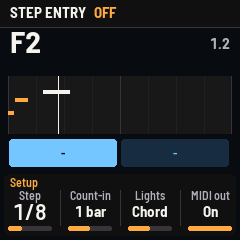
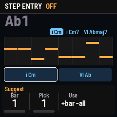
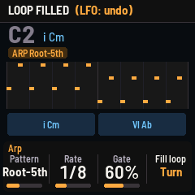

# BASSLINE for the M-VAVE FM-1

Custom firmware for writing bass lines on the FM-1, against a chord progression you already have or as
the start of an arrangement that a progression can be built from.

- **Ten basses**, all generated, no samples: 808, Finger, Pick, Slap, Muted, Fretless, Upright (plucked-string
  models), Acid, Sub, Reese.
- **One note at a time, with glide and legato**: hold a key and press another to slide there; ENV forces a slide.
- **Shaped and bent**: the 808's punch, dive and dive time; four kinds of drive (warm, hard clip, wavefold, fuzz);
  a tail that drops the note when you let go; a Bend knob that bends live and springs back; a tempo-synced wobble.
- **A loop of 1–8 bars**, recorded live (quantized to 16ths, over what's there) or entered step by step, with undo.
- **A progression**, one chord per bar from the key. The keys light up with the bar's chord, and Snap can pull wrong
  notes into the scale or the chord.
- **A bass arpeggiator** (root, octaves, fifths, walks, pumps) on a held key, or **Fill**: the whole loop written
  from the progression.
- **Suggest**: the chords that fit each bar of the bass line you played, best first. One turn makes them the
  progression.

It is built on [CHORDS](https://github.com/Mighty-stack444/Chords-fm1), and through it on
[FoMni](https://github.com/charlesvestal/fm1-fomni) and the community FM-1 platform
([Felucca](https://github.com/hugelton/Felucca)): the hardware layer, USB, storage, safe mode and the installer are
theirs. The instrument and the UI are new.

> **Status: not yet run on a real FM-1.** It passes every test in the simulator (the whole app, UI and sound, on a
> computer) and in the browser emulator. Try it in the browser first.

  

## Controls

| Control | Does |
| --- | --- |
| Keys | The bass, chromatic, F to G over two octaves (OCT− / OCT+ move them) |
| ENV | Held with a key: slide into that note. Step entry: a tie |
| PLAY | The loop on / off. From step entry: record live, after the count-in |
| REC | Loop playing: recording on / off. Stopped: step entry on / off |
| LFO | Undo the last recording, step entry, fill or clear (again: redo). Held 1.5 s: clear. Step entry: a rest |
| ARP | The bass arpeggiator on / off |
| SELECT / ALGORITHM / PRESETS | Scale (step entry: the cursor) / root / sound |
| HOME FX SEQ SEL GLO | Pages Sound, Glide, Loop, Prog, Setup. EDIT steps through all nine (with Shape, Bend, Arp and Suggest) |
| KNOB 1–4 | The page's four values |
| SAVE | Saves the loop, the progression and the settings (it also saves by itself when stopped and quiet) |

| Page | KNOB 1 | KNOB 2 | KNOB 3 | KNOB 4 |
| --- | --- | --- | --- | --- |
| Sound | Tone | Decay | Drive | Level |
| Shape | Punch (the 808's hit, semitones) | Dive time | Character: Warm, Hard, Fold, Fuzz (the Drive's kind) | Tail (the note drops this far when let go) |
| Glide | Glide (time) | Mode: Retrig, Legato, Glide all | Slide (ENV's time) | Dive (808 dive; a scoop on the others) |
| Bend | Bend (turn: bends live, half a step a detent, up to an octave) | Return (how fast it springs back; Hold: it stays) | Wobble (a vibrato) | Rate (in time with the tempo) |
| Loop | Bars | Tempo | Swing | Click: off, while recording, always |
| Prog | Bar | Chord (scale degree) | 7th | Snap: off, scale, chord |
| Arp | Pattern | Rate | Gate | Fill loop (turn) |
| Suggest | Bar | Pick | Use (right: this bar; left: every bar) | |
| Setup | Step (note length) | Count-in | Lights | MIDI out |

MIDI: notes in (USB or the TRS jack, any channel) play the bass and pitch bend bends it; the bass goes out on
channel 1.

## Build and install

The same way as CHORDS. The version number is in the `VERSION` file.

1. Push this folder to a GitHub repository (it contains `.github/workflows/build.yml`).
2. In the repository: **Settings › Pages › Source: GitHub Actions**.
3. Every push builds the firmware, runs the tests and publishes a site with the emulator, the web installer and the
   `.fwsc` download.

Locally: see [BUILDING.md](BUILDING.md).

## Safety

Installing custom firmware is at your own risk. The installer can put M-VAVE's own firmware back (or CHORDS, or
any other); after two failed starts BASSLINE stays in a safe mode with USB on; holding OCT− and OCT+ for 5 seconds
enters update mode. M-VAVE's M-UPGRADE also restores stock firmware.

## Tests

`tests/run_tests.sh` runs the platform tests and the whole app in the simulator: `tests/scenarios/loop.omni`
(legato, step entry, playback, live recording, undo, clear, suggestions, snap, fill, the arp, saving),
`play.omni` (modes, ENV slides, MIDI in, the count-in, the arp recorded) and `sounds.omni` (every sound, its pitch
and level). Screenshots and audio land in `build/scenarios/`.

## Licence

GPL-3.0-only, as the platform it is built on. See [LICENSING.md](LICENSING.md).
